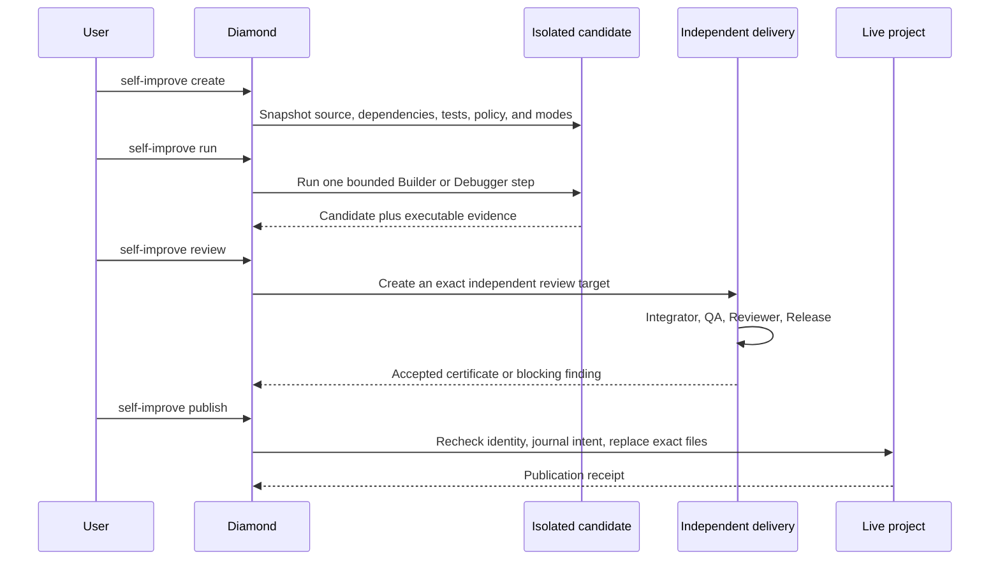

<div align="center">

# Diamond Orchestrator

### Local control for evidence-backed AI workflows

<p>
  A Python controller that routes bounded work to configured CLI providers,
  records what happened, and requires evidence before a change can move forward.
</p>

<p><strong>Destiny × Niyati = Radha</strong></p>

<p>
  <a href="docs/aim/PROJECT_AIM.md">Project aim</a> ·
  <a href="docs/architecture/SYSTEM_DESIGN.md">System design</a> ·
  <a href="docs/progress/STATUS.md">Current status</a> ·
  <a href="docs/verification/COUNCIL_M0_M1.md">M0/M1 verification</a>
</p>

</div>

> A request enters as validated data. It moves through an explicit route,
> isolated workspaces, executable checks, and durable evidence. A change reaches
> the live project only when the recorded gates accept the exact candidate.

## Why this project exists

AI coding workflows often put the interesting parts in a prompt and leave the
hard parts implicit: which provider ran, which files changed, whether the test
actually ran, whether the result belongs to the current source, and what should
happen after an interrupted process.

Diamond makes those parts controller-owned. It gives a local project one place
to validate requests, route roles to providers, supervise external processes,
record immutable events, bind evidence to exact bytes, and recover from
ambiguous outcomes.

The project is designed for bounded local operation. It does not treat a model
response as permission, a successful process exit as proof of acceptance, or a
provider label as proof of model identity.

## The project aim

Diamond aims to make multi-provider AI work inspectable and reversible without
turning the controller into another open-ended agent runtime.

It does that by:

- keeping configuration, roles, permissions, tests, and source ownership
  explicit;
- routing a role to an eligible provider through a validated task packet;
- recording intent, attempts, process identity, results, artifacts, and test
  evidence in a local SQLite ledger;
- separating provider claims from controller-observed facts;
- requiring independent delivery stages before a candidate can be published;
- retaining failure evidence and recovery intent instead of hiding uncertainty;
- exposing the same controller through the CLI, MCP stdio, and a native macOS
  operations console.

The repository also contains the planning and verification record for a future
dynamic-agent pilot. That pilot remains planned. The current implementation is
the repaired fixed-routing foundation that the pilot must build on.

## The workflow

The path below shows how a request moves through the system. The arrows are
control boundaries, not a promise that every command launches a provider.

```mermaid
flowchart LR
    request[CLI, MCP, or macOS console] --> validate[Validate input, config, and paths]
    validate --> ledger[SQLite ledger and immutable events]
    ledger --> route[Resolve role and provider route]
    route --> workspace[Create owned isolated workspace]
    workspace --> adapter[Provider adapter and process supervisor]
    adapter --> evidence[Record actual result, artifacts, and tests]
    evidence --> decision{Evidence supports the next state?}
    decision -->|No| blocked[BLOCKED with reason and recovery evidence]
    decision -->|Yes| verify[Workflow verification]
    verify --> review[Independent delivery review]
    review --> certificate[Accepted certificate for exact candidate]
    certificate --> publish[Journal publication intent]
    publish --> live[Replace matching live files]
    publish --> recover[Reconcile or roll back on interruption]

    classDef entry fill:#182235,stroke:#8ba4c7,color:#f4f7fb;
    classDef control fill:#202d2a,stroke:#78c6a3,color:#f4f7fb;
    classDef evidence fill:#342b1d,stroke:#e4b667,color:#f4f7fb;
    classDef blocked fill:#351f25,stroke:#df7e8e,color:#f4f7fb;
    class request entry;
    class validate,ledger,route,workspace,adapter control;
    class evidence,verify,review,certificate,publish,live,recover evidence;
    class blocked blocked;
```



### What happens at each boundary

| Stage | Controller responsibility | Result |
| --- | --- | --- |
| Request | Parse the CLI or protocol input and reject malformed identifiers, paths, fields, and limits. | A typed command or a clear error. |
| Route | Resolve the configured role, provider, skills, tests, timeout, and correction budget. | A frozen task packet. |
| Workspace | Capture the accepted base, owned paths, dependencies, policy inputs, tests, and modes. | An isolated workspace with a known source identity. |
| Execution | Launch an explicit executable argv through the provider adapter and supervisor. | Bounded output, process observations, and a normalized outcome. |
| Evidence | Check actual exit status, artifact digests, test output, session identity, and candidate lineage. | Evidence tied to a task, attempt, revision, and exact bytes. |
| Review | Run the independent Integrator, QA, Reviewer, and Release stages against the candidate. | A certificate or a retained blocking finding. |
| Publication | Recheck live dependencies and source identity, journal the intent, and replace only the accepted files. | Published bytes, or a recoverable interrupted state. |

## Provider and role routing

The portable configuration currently defines six provider entries and nine
model-backed roles. Enabling a provider only makes it eligible for routing. It
does not prove that the binary exists, that authentication works, or that a
live model request is available.

| Role | Default provider | Work represented by the role |
| --- | --- | --- |
| Planner | Antigravity | Break a bounded goal into an executable plan. |
| Researcher | Antigravity | Gather bounded context for a planned task. |
| Architect | Claude | Shape contracts and implementation boundaries. |
| Builder | Claude | Produce a candidate inside the owned workspace. |
| Integrator | Claude | Select and combine verified workflow components. |
| Debugger | Codex | Reproduce a failure and propose a bounded correction. |
| QA | Copilot | Run an independent candidate check. |
| Reviewer | Codex | Inspect the candidate and inherited findings independently. |
| Release | Copilot | Perform the final scoped acceptance stage. |

The provider entries are Gemini, Antigravity, Codex, Omnirush, Copilot, and
Claude. The route map lives in [`config/diamond.toml`](config/diamond.toml),
where command names resolve through the host `PATH`.

## Architecture

Diamond keeps the controller small and local. Python 3.11+, the standard
library, SQLite, and `asyncio` provide the foundation.

| Layer | What it owns | Source |
| --- | --- | --- |
| CLI and configuration | Commands, JSON envelopes, config validation, diagnostics, and path resolution. | [`src/diamond/cli.py`](src/diamond/cli.py), [`src/diamond/config.py`](src/diamond/config.py) |
| MCP bridge | Newline-delimited JSON-RPC over the same controller. Mutations require explicit confirmation. | [`src/diamond/mcp_server.py`](src/diamond/mcp_server.py) |
| Domain and contracts | Roles, providers, task states, workflow states, delivery states, and legal transitions. | [`src/diamond/domain.py`](src/diamond/domain.py), [`src/diamond/workflow_contracts.py`](src/diamond/workflow_contracts.py), [`src/diamond/delivery_contracts.py`](src/diamond/delivery_contracts.py) |
| Event ledger | SQLite transactions, append-only events, projections, command deduplication, replay, migration, and backup. | [`src/diamond/store.py`](src/diamond/store.py), [`src/diamond/schema.py`](src/diamond/schema.py) |
| Dispatch and supervision | Provider-specific argv, capability probes, bounded output, deadlines, process groups, and cleanup observations. | [`src/diamond/adapters.py`](src/diamond/adapters.py), [`src/diamond/supervisor.py`](src/diamond/supervisor.py) |
| Workspace and evidence | Owned paths, canonical manifests, artifact digests, test inputs, provider evidence, and review provenance. | [`src/diamond/workspace.py`](src/diamond/workspace.py), [`src/diamond/evidence.py`](src/diamond/evidence.py), [`src/diamond/test_inputs.py`](src/diamond/test_inputs.py) |
| Improvement service | Isolated candidate creation, independent delivery review, publication journaling, cancellation, rollback, reconciliation, and scoped evidence analysis. | [`src/diamond/self_improve_cli.py`](src/diamond/self_improve_cli.py), [`src/diamond/improvement_publication.py`](src/diamond/improvement_publication.py), [`src/diamond/improvement_evidence.py`](src/diamond/improvement_evidence.py) |
| Interfaces | Shell, dashboard, native macOS console, and live verification drivers. | [`src/diamond/shell.py`](src/diamond/shell.py), [`src/diamond/dashboard.py`](src/diamond/dashboard.py), [`examples/DiamondMac`](examples/DiamondMac) |

### The durable state model

The project stores runtime state in `.diamond/diamond.sqlite3` by default.
Events are historical facts. Projections can be rebuilt from them. Commands
carry idempotency keys, revisions use compare-and-set checks, and failed
transactions roll back together instead of leaving a state projection without
its event.

The current schema includes the core task and workflow records, attempts,
evidence, delivery records, improvement checkpoints, publication journals,
cancellation fences, and evidence dispositions. Existing ledgers require the
explicit migration command. Diamond does not silently upgrade a database while
handling another request.

## Gated self-improvement

Self-improvement is a separate, stricter path. A verified workflow does not
write directly into the live repository.



The publication path protects the boundary in both directions:

- A candidate cannot publish without an independently accepted delivery.
- A changed dependency, policy file, test input, candidate, or live source
  invalidates the publication attempt.
- Cancellation persists a fence that late results cannot cross.
- An interrupted multi-file replacement retains original bytes, candidate
  bytes, modes, and intent for a fresh-process reconciliation.
- Rollback preserves a newer human edit instead of overwriting it.
- A lost completion receipt leaves the intent in a recoverable state.

This is evidence-backed source change management. It is not unrestricted
self-training, automatic code rewriting, or a promise of global atomicity across
the filesystem and SQLite.

## Daily improvement analysis

`daily-improve analyze` is read-only discovery. It verifies stored evidence,
uses an indexed row and byte bounded snapshot, scopes records to the current
project, keeps citations, and separates task lineage from repeated evidence.
It does not launch a provider or publish a source change.

```sh
./scripts/diamond.sh --json daily-improve analyze \
  --window-hours 168 \
  --max-candidates 5 \
  --max-records 1000 \
  --max-bytes 8388608
```

An operator can record an evidence-cited disposition for a current candidate:

```sh
./scripts/diamond.sh --json daily-improve disposition \
  --signature SIGNATURE \
  --source-digest SOURCE_DIGEST \
  --status deferred \
  --reason "Await a reproducible baseline" \
  --evidence-id EVIDENCE_ID \
  --cooldown-hours 24 \
  --command-id candidate-decision-1
```

Dispositions are immutable, scoped to the current source digest, and
idempotent by command ID. The supported statuses are `resolved`,
`inapplicable`, `failed_experiment`, and `deferred`.

## Run it locally

### Requirements

- macOS for the native console example.
- Python 3.11 or newer for the controller and tests.
- Provider command-line tools only when running provider probes or execution.
- Swift and Swift Package Manager only when building the native console.

### Validate the foundation

```sh
./scripts/diamond.sh --config config/diamond.toml validate-config
./scripts/diamond.sh --config config/diamond.toml doctor
./scripts/diamond.sh --json project status
./scripts/check.sh
```

`doctor` performs bounded version probes. It reports authentication as
`NOT_CHECKED`; a configured provider is not automatically treated as ready.
The check script discovers the standard-library test suite and compiles Python
sources in memory without writing bytecode.

### Create and inspect a task record

Task creation records a validated task. It does not launch a provider.

```sh
./scripts/diamond.sh --config config/diamond.toml \
  task create \
  --objective "Record a bounded example task" \
  --role builder \
  --command-id example-task-1
```

Use the returned ID with:

```sh
./scripts/diamond.sh task list
./scripts/diamond.sh task show TASK_ID
./scripts/diamond.sh task events TASK_ID
./scripts/diamond.sh task attempts TASK_ID
./scripts/diamond.sh task evidence TASK_ID
```

### Run a bounded workflow

The workflow interface requires an explicit workspace, owned paths, trusted
tests, and a command ID. A workflow step uses the configured Builder or
Debugger route and records its result in the ledger.

```sh
./scripts/diamond.sh --json workflow create \
  --objective "Improve the workflow status explanation" \
  --workspace /absolute/path/to/isolated-workspace \
  --owned-path src/diamond/workflow_cli.py \
  --test '{"name":"controller suite","argv":["/bin/sh","scripts/check.sh"],"timeout_seconds":900,"output_limit":65536}' \
  --command-id workflow-example-1

./scripts/diamond.sh --json workflow run WORKFLOW_ID --expected-revision 1
./scripts/diamond.sh --json workflow status WORKFLOW_ID
./scripts/diamond.sh --json workflow events WORKFLOW_ID
```

### Inspect the native console

```sh
./scripts/local.sh status
./scripts/local.sh doctor
./scripts/local.sh check
swift build --package-path examples/DiamondMac
```

The console reads and changes state through the Python controller. It does not
call provider CLIs directly. The Logs screen reads immutable workflow events,
including events from a gated self-improvement workflow.

### Use the MCP bridge

```sh
./scripts/diamond.sh \
  --project "$PWD" \
  mcp --stdio
```

The transport is newline-delimited JSON-RPC. Read-only tools inspect project
status, workflows, events, deliveries, and configuration. Mutating tools
require `confirm: true` and remain subject to the controller's validation and
evidence gates.

## Safety boundaries

Diamond makes several boundaries visible in its interface and its failure
states:

| Boundary | What Diamond does |
| --- | --- |
| Provider trust | Treats provider output as an untrusted report until the controller validates it. |
| Source ownership | Rejects traversal, symlink escape, unowned changes, protected controller files, and stale bases. |
| Test claims | Requires actual commands, exit status, output evidence, and cleanup observations. |
| Process ambiguity | Keeps uncertain cleanup or completion in `BLOCKED` until an explicit reconciliation decision exists. |
| Credentials | Keeps secrets out of portable TOML and the ledger, with redaction before persistence. |
| Migration | Requires an explicit schema migration instead of silently changing a live ledger. |
| Publication | Requires an accepted exact candidate and preserves recovery intent across interruption. |

The current release posture is a bounded local release candidate, not a
production certification. Live authentication, packaging, clean installation,
and broader release gates remain separate requirements.

## Current status

The latest M0/M1 checkpoint records:

| Area | Status |
| --- | --- |
| Controller and macOS console | Verified locally |
| Python regression suite | 330 tests passed |
| Python source compilation | 90 files compiled in memory |
| Native console build | Passed with Swift Package Manager |
| Self-improvement publication | Independent review, cancellation, rollback, and reconciliation implemented |
| Daily improvement | Scoped, bounded, evidence-cited analysis implemented |
| Live provider authentication | Partial and environment-dependent |
| Dynamic profile pilot and adaptive routing | Planned for later milestones |
| Production certification | Not complete |

See the [full status record](docs/progress/STATUS.md) and the
[M0/M1 verification record](docs/verification/COUNCIL_M0_M1.md) for commands,
scope, limitations, and evidence.

## Repository map

```text
config/      Portable TOML configuration and pinned advisory skills
docs/        Aim, architecture, plans, decisions, gates, and evidence
examples/    Native DiamondMac SwiftUI operations console
scripts/     Project launcher, checks, and live verification drivers
src/diamond/ Python controller, ledger, adapters, workflows, and interfaces
tests/       Unit, black-box, integration, recovery, and stress tests
```

## Read next

1. [Project aim](docs/aim/PROJECT_AIM.md) explains the objective and delivery
   order.
2. [System design](docs/architecture/SYSTEM_DESIGN.md) explains contracts,
   state, routing, evidence, and recovery.
3. [Roles and skills](docs/architecture/ROLES_AND_SKILLS.md) explains packet
   binding and advisory skill provenance.
4. [Dynamic agents plan](docs/plan/DYNAMIC_AGENTS_PLAN.md) separates the
   verified foundation from the planned profile pilot.
5. [Phase gates](docs/verification/PHASE_GATES.md) explains what must pass before
   the next milestone can begin.
6. [Documentation hub](docs/README.md) contains the complete internal index.

<div align="center">

<sub>Diamond Orchestrator · Destiny × Niyati = Radha</sub>

</div>
